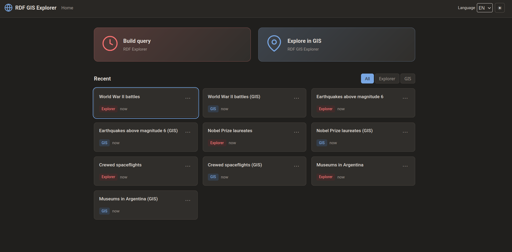
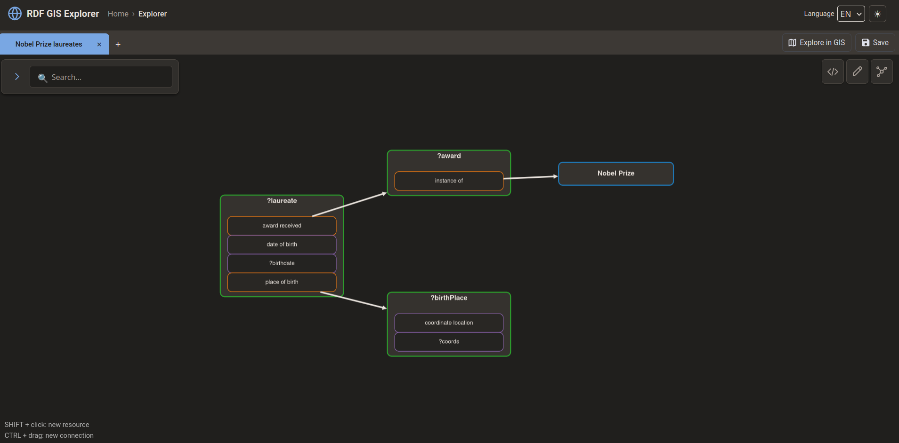
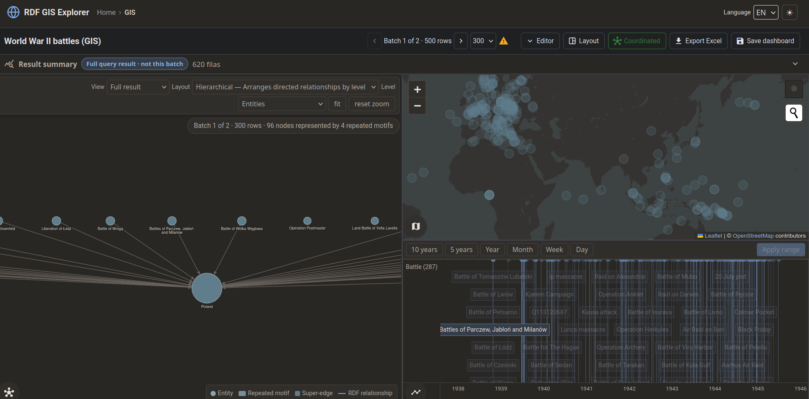

# RDF GIS Explorer

A data exploration platform for graph databases accessible through SPARQL 1.1.
It integrates three deployable products:

- **Shell**: navigation, integration, and dashboard persistence.
- **RDF Explorer**: visual SPARQL query construction, based on the original
  [RDF Explorer](https://github.com/hvarg/RDFExplorer) (see [Credits](#credits)).
- **GIS Explorer**: coordinated analysis through table, graph, map, and timeline views.

The platform is independent of both the data domain and any specific engine.
The explorers' backend uses a SPARQL client configurable by URL, credentials,
prefixes, and limits. The bundled configuration targets Wikidata to provide an
immediately usable demo.

Process and responsibility boundaries are detailed in
[docs/product-architecture.md](docs/product-architecture.md). Design decisions
are documented in [docs/design-decisions.md](docs/design-decisions.md) and
[docs/graph-rendering-decisions.md](docs/graph-rendering-decisions.md).

## Quick start with Wikidata demo dashboards

With nvm and corepack/pnpm installed, run these commands from the repository
root to create the demo dashboards and start the platform with the bundled
Wikidata configuration:

```bash
nvm use
corepack enable
pnpm install
pnpm --dir products/shell/backend run seed:demo-dashboards
./start.sh
```

Open http://localhost:4200 and choose a demo dashboard from the welcome page.
The seed creates five RDF Explorer workspaces and five equivalent GIS dashboards in
`products/shell/backend/data/wikidata.sqlite` by default. Opening a dashboard
executes its saved query against live Wikidata to populate the views.

The seed validates the queries against Wikidata before saving. To create the
dashboards without that remote validation, use:

```bash
pnpm --dir products/shell/backend run seed:demo-dashboards -- --no-validate
```

Wikidata access is still required when opening the dashboards. To preview and
validate the seed without writing to SQLite, use:

```bash
pnpm --dir products/shell/backend run seed:demo-dashboards -- --dry-run
```

Running the seed again replaces demo dashboards with matching names. If you
override `DASHBOARDS_SQLITE_PATH`, check the target database before running it;
relative paths are resolved from `products/shell/backend`.

## Visual tour

### Shell

The entry point brings the explorers together and lets users open, manage, and
resume saved dashboards.



### RDF Explorer

The visual builder models a query as a graph and generates its SPARQL
representation without relying on a specific domain.



### GIS Explorer

Results are explored through four coordinated views: map, timeline, table, and
graph.



## Technology stack

| Area | Technologies | Role |
| --- | --- | --- |
| Language and runtime | TypeScript 5.9, Node.js 24.18.0 | Shared contracts, frontend and backend code |
| Frontend | Angular 21, Angular Material/CDK, SCSS | Standalone components, UI controls and styling |
| Microfrontends | Native Federation 21 | Shell host and independently deployable RDF/GIS remotes |
| Reactive state | Angular Signals, RxJS 7 | Application state and coordinated view updates |
| Backend | NestJS 11, class-validator, class-transformer | REST APIs, dependency injection and request validation |
| Persistence | SQLite, better-sqlite3 | Saved dashboards and workspaces in the Shell |
| RDF queries | SPARQL 1.1, sparqljs 3 | Configurable endpoint access and query parsing/validation |
| Graphs | Cytoscape.js 3, cola and dagre layouts | Visual query builder and graph exploration |
| Maps | Leaflet 1.9, markercluster, leaflet-draw, Turf.js | Geographic visualization, clustering and polygon filtering |
| Tables and timeline | AG Grid 35, vis-timeline 8 | Tabular results and temporal exploration |
| Query editor and export | CodeMirror 6, ExcelJS 4 | SPARQL editing and XLSX export |
| Workspace and deployment | pnpm workspaces, Docker Compose | Monorepo dependencies and containerized services |
| Tests and linting | Jest 30, Vitest 4, nock, supertest, ESLint 9 | Backend/frontend tests, HTTP mocks and static checks |

## Local development

Requirements: Node.js 24.18.0, corepack/pnpm, and nvm for the complete
bootstrap flow.

```bash
./start.sh

# Use a custom SPARQL configuration
./start.sh --env .env.custom
```

`start.sh` activates the Node version, installs dependencies when
necessary, and starts all three frontends and backends with hot reload.

| Service | URL |
| --- | --- |
| Shell | http://localhost:4200 |
| Integrated RDF Explorer | http://localhost:4200/explorer |
| Integrated GIS Explorer | http://localhost:4200/gis |
| Shell API | http://localhost:3000/api |
| RDF API | http://localhost:3001/api |
| GIS API | http://localhost:3002/api |

Each explorer can also run with its own runtime:

```bash
pnpm run dev:rdf-standalone
pnpm run dev:gis-standalone
docker compose up
```

## Structure

```text
packages/
  contracts/          types shared by backends and frontends
  platform-bridge/    Shell-to-remote integration contracts
  explorer-backend/   shared SPARQL runtime, without dashboard persistence
products/
  shell/              host and dashboard-only API
  rdf-explorer/       visual query builder and its own runtime
  gis-explorer/       coordinated views and its own runtime
```

The remotes use `/api` in standalone mode. When integrated into the
Shell, the bridge configures `/rdf-api` and `/gis-api`. Only the
Shell exposes `/api/dashboards` and accesses SQLite.

## API

The explorer runtimes expose query execution and summaries, suggestions,
configuration, and health checks under `/api`. The Shell exposes
CRUD operations at `/api/dashboards` and `/api/dashboards/recent?limit=N`.
Query execution is read-only: SPARQL Update requests are rejected with
`400 READ_ONLY`.

## AI integration (MCP)

The Shell backend includes an optional [Model Context Protocol](https://modelcontextprotocol.io)
server at `/api/mcp` (Streamable HTTP, stateless). Any MCP client (Claude Code,
Claude Desktop, Cursor, VS Code, Gemini CLI, and others) can use it to explore
the graph, answer questions with SPARQL, and create GIS dashboards that people
then open in the app.

| Tool | What it does |
|------|--------------|
| `describe_endpoint` | Backend, default prefixes, and query limits |
| `graph_overview` | Classes by instance count and properties by usage, with exact counts (can take up to a minute on large graphs; each section degrades on its own) |
| `search_catalog` | Classes, properties, or resources by label or URI |
| `explore_connections` | Incoming/outgoing properties of a class, resource, or property, with examples (inferred `owl:Thing` duplicates removed) |
| `find_paths` | Property paths from a class to another class or property |
| `describe_resource` | One node's types, label, values and neighbours, with outgoing blank nodes expanded one level, plus the resources pointing to it |
| `run_select` | Runs a self-contained `SELECT` and returns a capped set of rows and the detected type per variable |
| `preview_dashboard` | Runs a query the way the GIS dashboard will and reports what each view will show, the real total, duplicate rows and warnings |
| `profile_space_time` | Where and when a query's entities concentrate: bounding box, suggested map view, grid hotspots, suspicious coordinates ((0,0), swapped or equal lat/lon, far away), adaptive date histogram, peaks and gaps |
| `scope_query` | Rewrites a query restricted to an area (bbox, or centre and radius in km) and/or a period. Reads WKT `POINT`s with plain SPARQL 1.1, so it needs no GeoSPARQL support |
| `list_dashboards`, `get_dashboard` | Saved dashboards with their links and queries |
| `create_gis_dashboard` | Saves a new GIS dashboard and returns its link. The map opens framed on the data (outliers excluded); optionally choose the views and their order, the map view, the timeline window, the table's primary entity and an entity selected on open |

The `suggest_dashboards` prompt (an optional `topic` argument) walks the graph
looking for geometry, dates, and relationships, validates candidate queries
with `preview_dashboard`, and proposes dashboards before creating any. The
`explore_graph` prompt (a `question` argument) answers a question by walking
the graph and cites the URIs and the final query. There are no tools to modify
data or to update or delete dashboards.

### Enable and connect the MCP server

The server is **off by default**: `/api/mcp` answers `404` until `MCP_TOKEN` is
set in the environment of the Shell backend.

1. **Choose a token** and add it to the environment file you start the app
   with (`.env` by default, or the file passed to `./start.sh --env …`):

   ```bash
   openssl rand -hex 32          # any long random string works
   ```

   ```dotenv
   MCP_TOKEN=<the-token>
   # Base URL used in the dashboard links the agent returns:
   MCP_PUBLIC_APP_URL=https://<host>
   ```

   With Docker Compose, put the same variables in the `.env` file next to
   `docker-compose.yml` (or export them) before `docker compose up`; the
   compose file already points the tools at the GIS backend.

2. **Restart** the app (`./start.sh` or `docker compose up -d shell-backend`).
   The Shell backend reads the variables only at startup.

3. **Check** that the endpoint answers. The URL is the app's URL plus
   `/api/mcp` (`http://localhost:4200/api/mcp` in development):

   ```bash
   curl -s -X POST http://localhost:4200/api/mcp \
     -H "Authorization: Bearer <the-token>" \
     -H "Content-Type: application/json" \
     -H "Accept: application/json, text/event-stream" \
     -d '{"jsonrpc":"2.0","id":1,"method":"tools/list","params":{}}'
   ```

   `404` means `MCP_TOKEN` is not set (or the app was not restarted); `401`
   means the token does not match.

4. **Connect your AI client.** Claude Code:

   ```bash
   claude mcp add --transport http rdfgis http://localhost:4200/api/mcp \
     --header "Authorization: Bearer <the-token>"
   ```

   Clients configured with JSON (Claude Desktop, Cursor, VS Code, Gemini CLI,
   and others) take the same URL and header; the key names vary by client.
   Clients that only run local (stdio) servers can use the `mcp-remote` bridge:

   ```json
   {
     "mcpServers": {
       "rdfgis": {
         "command": "npx",
         "args": ["mcp-remote", "http://localhost:4200/api/mcp",
                  "--header", "Authorization: Bearer <the-token>"]
       }
     }
   }
   ```

5. **Try it**: ask the agent a question about the data, or run the
   `suggest_dashboards` prompt (in Claude Code,
   `/mcp__rdfgis__suggest_dashboards`; other clients list MCP prompts in their
   own menus).

| Variable | Default | Purpose |
|----------|---------|---------|
| `MCP_TOKEN` | — (server off) | Bearer token required by `/api/mcp` |
| `MCP_PUBLIC_APP_URL` | `http://localhost:4200` | Base URL used in dashboard links |
| `MCP_EXPLORER_API_URL` | `http://localhost:3002/api` | Explorer backend the tools call (`http://gis-backend:3002/api` in Docker) |
| `MCP_MAX_ROWS` | `100` | Rows returned to the agent per query |
| `MCP_EXPLORER_TIMEOUT_MS` | `120000` | Timeout for each explorer call |

Requests sent from a browser must also come from an origin listed in
`CORS_ORIGINS`; command-line and desktop clients send no origin. Keep the token
secret: anyone with it can query the endpoint and create dashboards.

Query results reach the model provider the client uses. Check that this is
acceptable for the data before connecting a cloud-hosted model.

## SPARQL configuration

The backend configuration is the single source of truth and reaches the
frontends through `GET /api/config`.

```env
SPARQL_BACKEND=custom
SPARQL_ENDPOINT_URL=https://example.org/sparql
SPARQL_USERNAME=
SPARQL_PASSWORD=
SPARQL_PREFIXES_PATH=packages/explorer-backend/config/prefixes.custom.json
CLASS_COLORS_PATH=packages/explorer-backend/config/class-colors.custom.json
```

Every `SPARQL_BACKEND` value other than `wikidata` uses the generic
SPARQL adapter. The `wikidata` mode adds only that service's public
integrations, such as its search API and `wikibase:label`.

Prefix files are JSON objects of the form `{ "prefix": "uri" }`. The backend does
not inject them at execution time: every query must be self-contained.

| Variable | Default | Purpose |
| --- | --- | --- |
| `SPARQL_BACKEND` | `wikidata` | Configuration identifier |
| `SPARQL_ENDPOINT_URL` | public Wikidata endpoint | SPARQL 1.1 URL |
| `SPARQL_USERNAME` / `SPARQL_PASSWORD` | — | Optional Basic Auth |
| `SPARQL_ENTITY_SEARCH_QUERY` | search by `rdfs:label` | Entity/resource search template (`$keyword`, `$limit`, optional `$offset`) |
| `SPARQL_SERVER_TIMEOUT_PARAM` | `timeout` for GraphDB; disabled elsewhere | Server timeout form parameter, in seconds; empty disables it |
| `SPARQL_TIMEOUT_MS` | `30000` | Timeout in ms |
| `SPARQL_CONNECT_TIMEOUT_MS` | `5000` | Max ms to open the connection to the endpoint (fails fast when it is unreachable, e.g. without VPN) |
| `SPARQL_MAX_LIMIT` | `300` | Rows per GIS batch and maximum rows per query request; does not cap the total result |
| `SPARQL_PREFIXES_PATH` | `config/prefixes.${SPARQL_BACKEND}.json` | Prefixes |
| `CLASS_COLORS_PATH` | `config/class-colors.${SPARQL_BACKEND}.json` | RDF colors |
| `DASHBOARDS_SQLITE_PATH` | `data/${SPARQL_BACKEND}.sqlite` | Shell SQLite database |
| `SPARQL_PROTECTED_BACKENDS` | `wikidata` | Databases preserved during cleanup |
| `GIS_GRAPH_MAX_NODES` | `300` | Graph node cap |
| `GIS_TABLE_PAGE_SIZE_OPTIONS` | `50,100,200` | Table page sizes |
| `EXPORT_MAX_ROWS` | `50000` | Full-export cap |
| `EXPORT_MIN_PAGE_SIZE` | `250` | Minimum retry page size |
| `SUMMARY_TOP_CATEGORICAL_LIMIT` | `12` | Number of top categorical values |

## Guided RDF discovery

RDF Explorer searches **classes** and **resources** by label or URI. Drag a class
onto the canvas to create a typed variable, or a resource to add that specific
entity. Resource search uses the endpoint's configured entity search; Wikidata
uses its public search API.

The right-hand **Explorer** panel shows incoming and outgoing relationships for
the selected variable or resource. Filter connections locally, then drag a
relationship onto the canvas to add a branch. **Agregar con tipo observado**
explicitly applies the observed class/datatype; dragging a concrete value
constrains the branch. Compatible existing branches are reused. Optionality and
value filters remain editable in the query editor.

Suggestions follow the connected graph structure and term types; canvas value
filters apply only when executing the query. Browsing catalogues without text,
property search, and connections use bounded samples. Text search for classes
builds a complete, temporarily cached vocabulary of observed and declared classes,
then filters and paginates that snapshot; its first request can take longer on a
large endpoint. The endpoint's inference and dataset scope apply.

Discovery is read-only, with caching, bounded queues and timeouts. Upstream
failures temporarily pause new discovery requests while cached results remain
available. Tune sampling, result limits, caching and request budgets through
`DISCOVERY_*` environment variables; defaults are defined in
[discovery.service.ts](packages/explorer-backend/src/modules/discovery/discovery.service.ts).
The class vocabulary uses `DISCOVERY_CLASS_VOCABULARY_PAGE_SIZE` (default 1000)
and `DISCOVERY_CLASS_VOCABULARY_TIMEOUT_MS` (default 45000) per upstream page.
Resource search can be customized with `SPARQL_ENTITY_SEARCH_QUERY`.

Explorer backends expose `GET /api/discovery/catalog`,
`POST /api/discovery/connections` and `POST /api/discovery/paths`, with shared types
in `@rdfgis/contracts`. The simplified panel uses catalogue and connections;
the path API remains available separately.

## Quality checks

```bash
pnpm -r --if-present test
pnpm -r --if-present build
docker compose config --quiet
git diff --check
```

## Credits

The RDF Explorer product builds on
[**RDF Explorer**](https://github.com/hvarg/RDFExplorer), the visual SPARQL
query builder and RDF explorer by Hernán Vargas, Carlos Buil-Aranda, Aidan
Hogan, and Claudia López ([live demo](https://rdfexplorer.org)). Its
graph-based query model (nodes, properties, and literals whose interactive
exploration builds the SPARQL query) is the foundation of this product.

This repository reimplements and extends that work: the Angular 21 frontend,
the configurable SPARQL backend, guided discovery, persistence, the Shell
integration, and the handoff to the GIS Explorer are new.

The original project is licensed under
[Creative Commons Attribution-NonCommercial-ShareAlike 4.0 International](https://creativecommons.org/licenses/by-nc-sa/4.0/).

If you use the RDF Explorer approach in academic work, please cite:

> Hernán Vargas, Carlos Buil-Aranda, Aidan Hogan, and Claudia López.
> *RDF Explorer: A Visual SPARQL Query Builder.* In *The Semantic Web – ISWC
> 2019*, LNCS 11778, pp. 647–663. Springer, 2019.
> [doi:10.1007/978-3-030-30793-6_37](https://doi.org/10.1007/978-3-030-30793-6_37)

## Contact

Martín M. Venturino — `marventurino@gmail.com`
